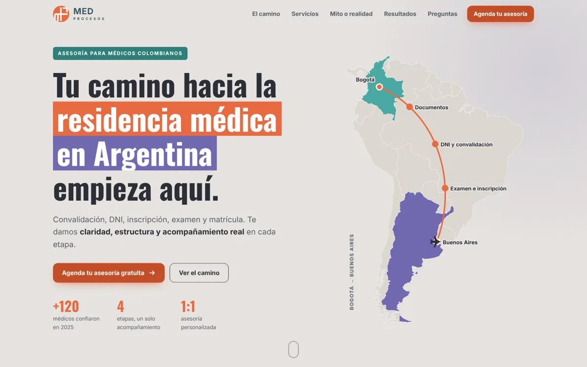
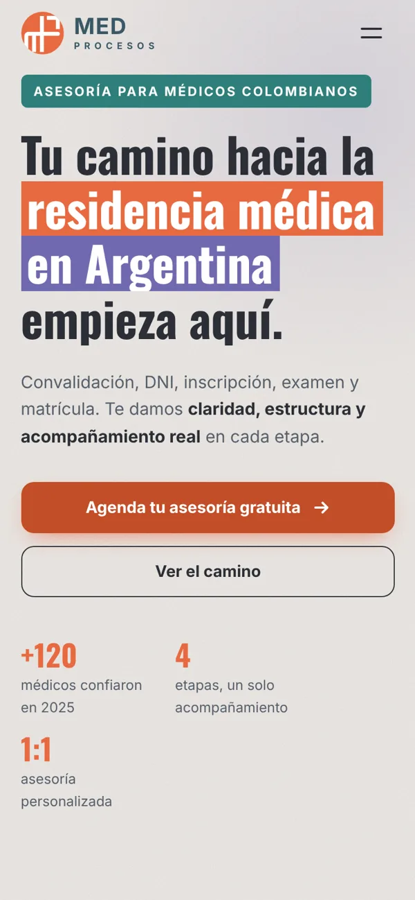
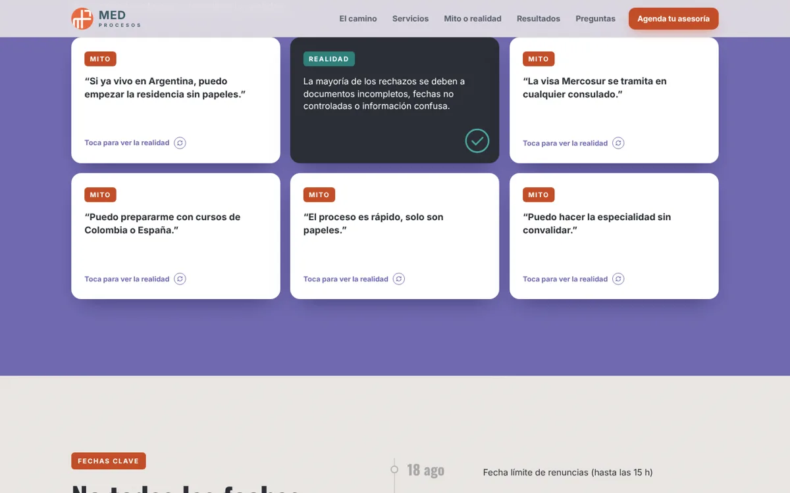

# Med Procesos · Landing (concepto de portafolio)

Landing page informativa con reserva de asesorías para **Med Procesos**, que acompaña a médicos colombianos a hacer su especialidad en Argentina. Es un **concepto de diseño para mi portafolio**, no el sitio oficial: el contenido se basa en sus publicaciones públicas de Instagram ([@med.procesos](https://www.instagram.com/med.procesos/)) y los botones de reserva llevan a sus canales oficiales (Calendly y WhatsApp). La página no recoge ni guarda datos.

 

## Qué tiene

- **Identidad de la marca:** isotipo redibujado en SVG con las proporciones del logo, paleta tomada de sus publicaciones (naranja `#E86A41`, lavanda `#706AB0`, verde azulado `#4AA9A3`, pizarra `#4D606E`, papel `#EBE8E5`) y el recurso de las frases resaltadas.
- **Mapa real:** siluetas de Suramérica generadas a partir de Natural Earth (dominio público), con la ruta Bogotá → Buenos Aires y sus cuatro etapas.
- **Animaciones propias**, no fundidos genéricos:
  - el logo se traza al cargar;
  - un avión recorre la ruta y marca cada parada;
  - las frases se "pintan" con la etiqueta de color;
  - el camino en 4 etapas avanza en horizontal mientras bajas (escritorio) o con una línea que se llena (celular);
  - los servicios se abren como una baraja;
  - las tarjetas de Mito o realidad giran en 3D;
  - el cronograma enciende sus fechas;
  - un mosaico de caras aparece alrededor del contador;
  - la lista de documentos se marca sola;
  - un sello se estampa junto a la reserva.
- **Celular primero:** carruseles deslizables para servicios, mitos e Instagram, menú a pantalla completa y scroll nativo (Lenis solo con mouse o trackpad).
- **Accesible:** contraste AA, navegación con teclado (pestañas con flechas, tarjetas que se voltean con Enter), "reducir movimiento" respetado.
- **Seguro:** Content-Security-Policy, sin CDNs de terceros (GSAP, ScrollTrigger y Lenis en `assets/vendor`), enlaces externos con `rel="noopener"`.



## Publicaciones de Instagram

La sección "Comunidad" muestra 4 publicaciones oficiales de @med.procesos con el **embed oficial de Instagram** (foto o video real, y enlace al post). El script de Instagram se carga solo al acercarse a la sección. Para cambiarlas, edita los `<blockquote class="instagram-media">` dentro de `#insta-grid` en `index.html`: cada uno lleva el enlace del post en `data-instgrm-permalink` y en su `<a>`. Si Instagram no carga (sin internet o con un bloqueador), se ve una tarjeta con el enlace a cada publicación.

Las fotos del equipo y de los médicos son de Med Procesos y de las personas que aparecen: no se copian al sitio. Si Med Procesos lo autoriza, se pueden agregar en `assets/img/`.

## Desarrollo

```bash
python3 -m http.server 8090      # http://localhost:8090
npm install
npx playwright install chromium  # solo la primera vez
npm test                         # 16 pruebas × escritorio, celular y movimiento reducido
```

Las pruebas revisan errores de consola, desbordes, enlaces, el mapa, las interacciones (menú, mitos, pestañas, preguntas), que todo quede visible tras las animaciones, accesibilidad con axe (WCAG 2 AA) y la CSP.

Al cambiar `assets/css/styles.css` o `assets/js/main.js`, sube el número `?v=` en `index.html` para que GitHub Pages no sirva la versión vieja.

Diseño y desarrollo: [modarox28](https://github.com/modarox28).
